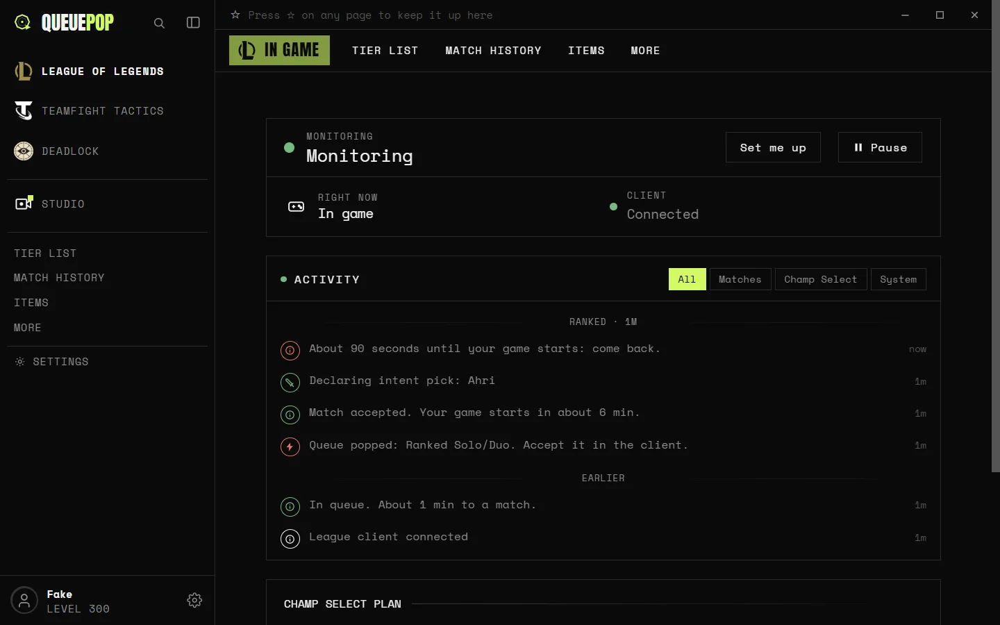
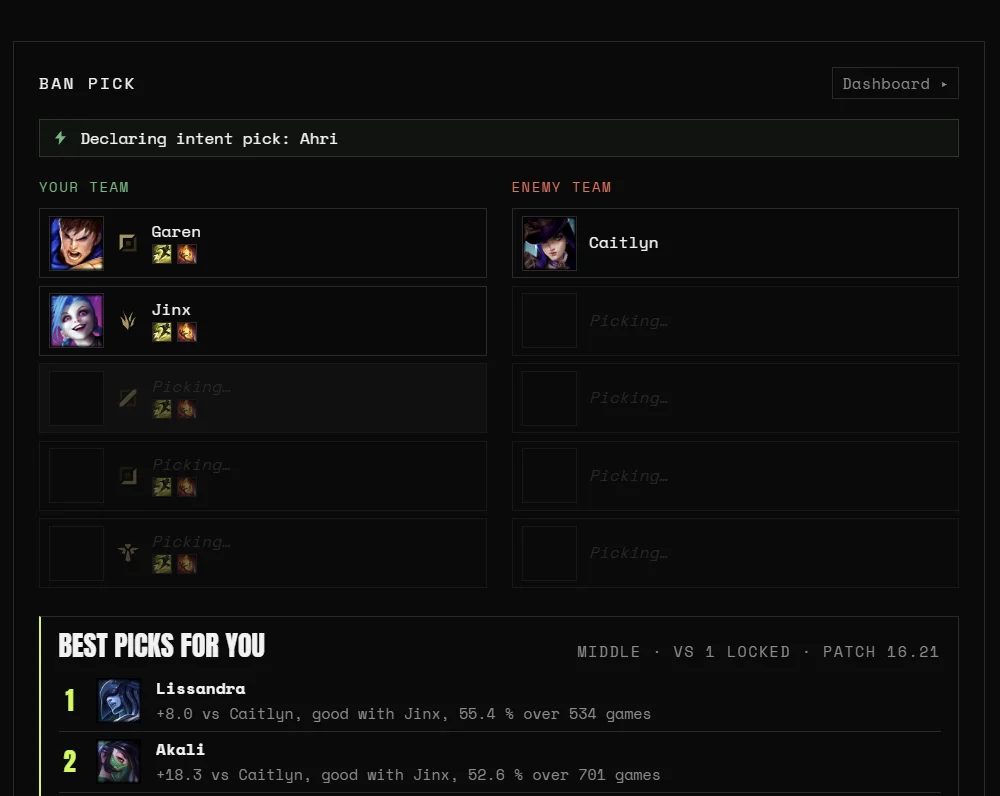
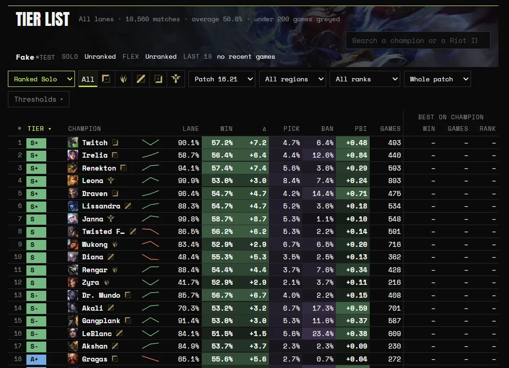
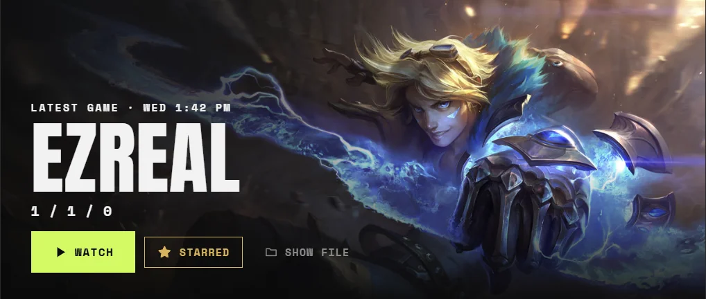

# queuePop

**[queuepop.app](https://queuepop.app)** · MIT · Windows 10 and 11

A desktop companion for **League of Legends**, **TFT** and **Deadlock**. Queue up and walk away: when the queue pops,
queuePop calls you back so you're at your PC in time to accept. Then it helps you draft, shows you the stats, and records
your best plays.



## The store build

The build going to the Overwolf app store (the store edition, [`app/edition.js`](app/edition.js)) calls you back and
highlights decisions. It never makes them: it never accepts a queue, locks in a champion, grabs from the ARAM bench or
sends a trade. You accept in the League client and you lock in. It's waiting on Riot's approval and isn't out yet.

- **Queue alerts** on your phone (the phone companion, on your Wi-Fi), ntfy push, Discord and Windows notifications.
  You can decline a match from your phone.
- **Champ select help:** the best picks for your role against the draft so far, and why. Your planned ban and pick are
  hovered on your turn, never locked. Runes, spells and skin are set once you lock in, plus a game plan for your
  champion: core build, skill order, matchups to watch.
- **Stats:** League tier lists and champion pages, TFT comps, units and items, Deadlock heroes and builds, leaderboards
  and player lookups.
- **Studio:** turn the recorder on and every game keeps a timeline of kills, deaths and objectives. With video on, your
  best moments are cut into clips as you play. Highlights puts your best plays first, and the player lets you cut your
  own clip. Everything stays on your PC.

Nothing runs in game: no overlays, no timers. It talks to the League client through Riot's local APIs and never reads
game memory.

| Champ select | Stats | Studio |
| :---: | :---: | :---: |
|  |  |  |

## The personal build

Built from source, queuePop keeps its automation: auto-accept, auto lock-in, ARAM bench grabs and trade requests. That
build is for your own use and isn't what goes to the store.

## Run from source

Needs Node.js and the League client (Deadlock pages need Steam).

```bash
cd app
npm install
npm start          # personal build on Electron
npm run start:ow   # on Overwolf's Electron, which Studio's game capture needs
npm test
```

Set `QP_EDITION=store` to try the store edition from source.

## Build

```bash
cd app
npm run dist       # personal build: installer + zip
npm run dist:ow    # store edition on Overwolf's Electron
```

The Python app under `src/*.py` is the retired first version and is on its way out. GitHub Releases still hold its
builds.

The public site lives in [`site/`](site/README.md).

---

queuePop isn't endorsed by Riot Games and doesn't reflect the views or opinions of Riot Games or anyone officially
involved in producing or managing Riot Games properties. Riot Games, League of Legends and Teamfight Tactics are
trademarks or registered trademarks of Riot Games, Inc. Deadlock and Steam are trademarks of Valve Corporation;
queuePop isn't affiliated with Valve.

[MIT License](LICENSE) © 2026 Brandon Harris
